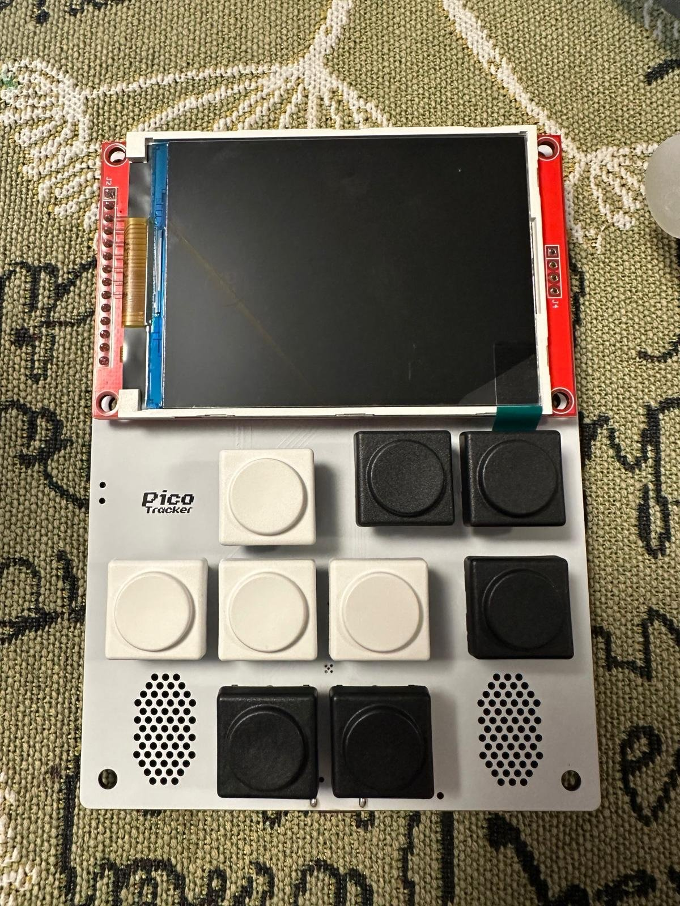
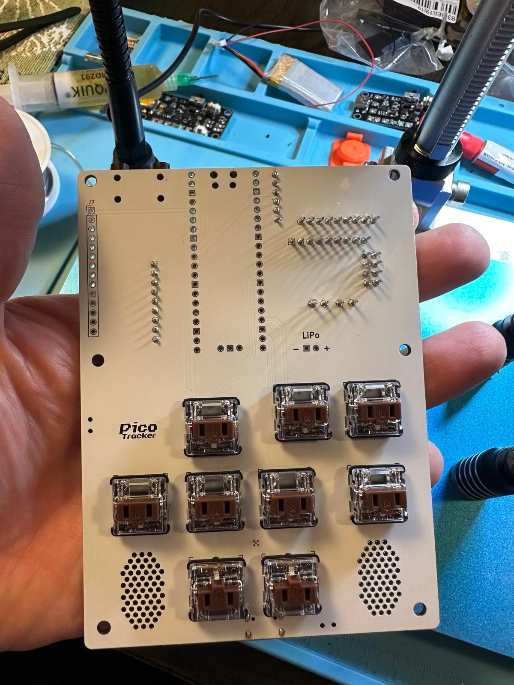
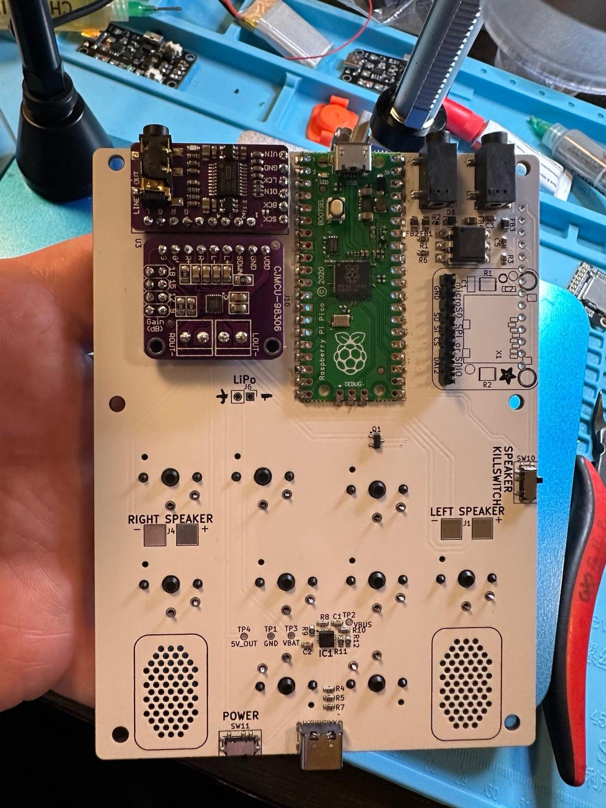
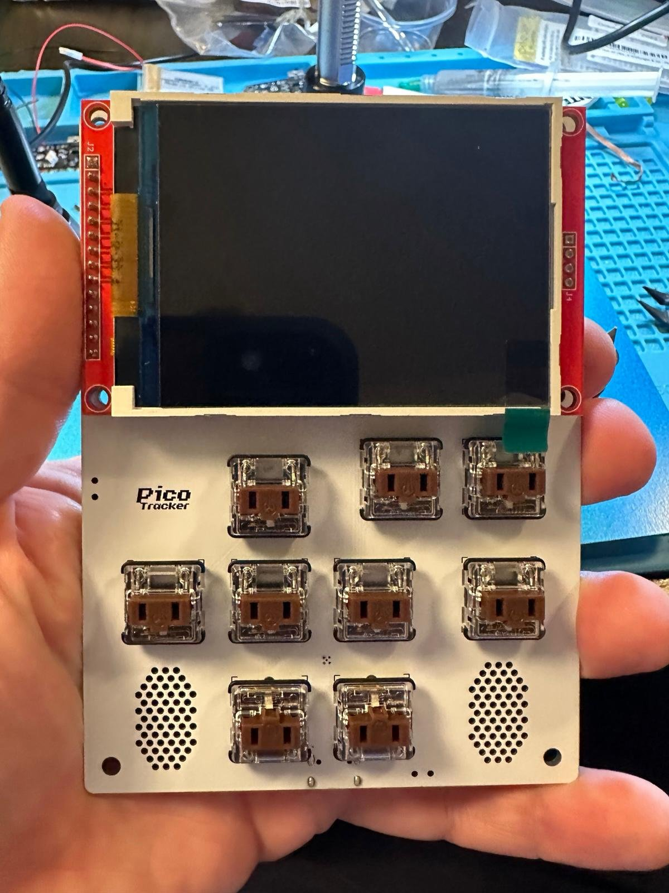
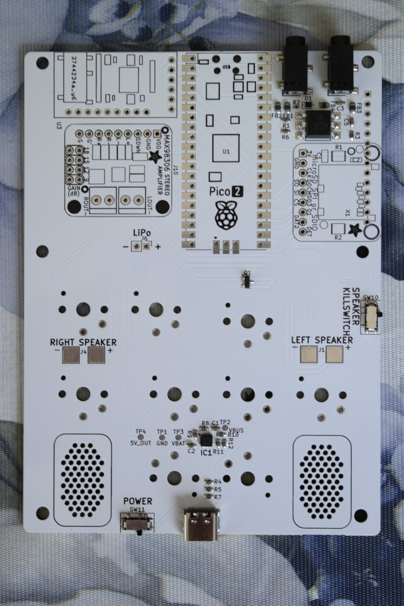
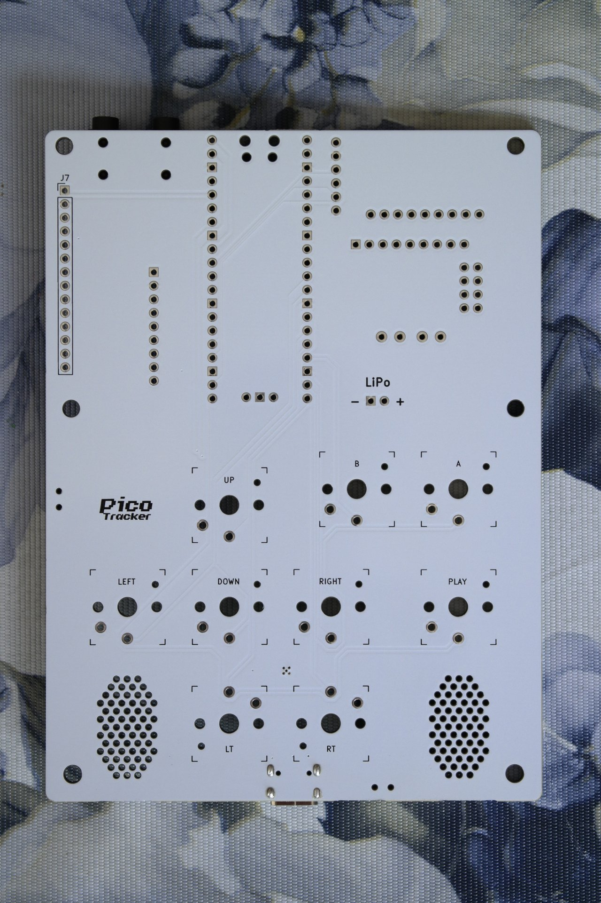
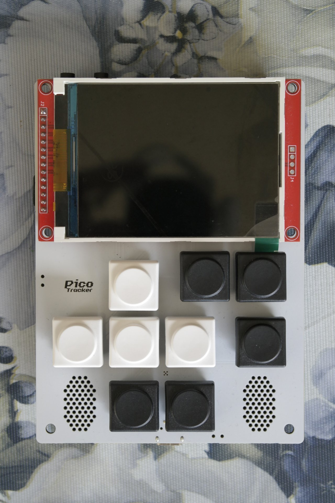

# JZ Pico Tracker

**A custom schematic and PCB that puts an entire handheld music tracker onto one board.**

    

---

## At a glance

|  |  |
|---|---|
| **Focus** | Embedded audio and portable instrument |
| **Started** | June 2023 |
| **Status** | Complete - board fabricated, populated and tested |
| **Core hardware** | Raspberry Pi Pico, PCM5102 DAC, MAX98306 amplifier, SD card, MIDI out, Li-ion charging |
| **Design tools** | KiCad, reflow and hand soldering, microscope-assisted inspection, 3D printing |
| **Scope** | Full schematic capture, PCB layout, BOM, fabrication, assembly and bring-up |

## Overview

The picoTracker is a handheld music sampler built on the PicoTracker project, whose firmware is LittleGPTracker - also known as piggytracker. The reference hardware realises it as two boards sandwiched together. This project consolidates that into a **single custom PCB** carrying the microcontroller, audio chain, storage, MIDI output, charging and the full key field.

The board is built around a Raspberry Pi Pico with a PCM5102 DAC for output and a MAX98306 class-D amplifier driving two micro speakers. Storage is an Adafruit MicroSD breakout on SPI, and MIDI out is opto-isolated with a 6N138. A BQ24232 handles Li-ion charging from the USB-C port, and nine Kailh Choc switches are soldered straight to the board rather than fitted into sockets.

**This board was designed against an older generation of the PicoTracker project and its hardware.** The upstream project has moved on since then - the fabrication warning that used to sit on the reference design has been resolved and the hardware has been revised - so this design should be read against the PicoTracker of its day rather than the current one.

### Goals

- Replace the two-board sandwich with one board that can be ordered from a fab and populated from a BOM.
- Keep the audio chain, storage, MIDI and charging on the same board without introducing ground or power noise between them.
- Keep the key field low-profile with Kailh Choc switches, matching the reference ergonomics.
- Have the BOM be a real, orderable part list rather than an assembly of loose breakouts.

### Planning and design

The schematic was split into the functional blocks the board actually needs: MIDI out, the Raspberry Pi Pico, the SD card on SPI, the charge circuit, the power tree, the switch field, and the amplifier and speaker outputs. Working block by block made it possible to check each rail and each interface against the reference behaviour before the layout was committed.

The layout was driven by the display and the key field, since those fix the outline of the board. The Pico sits centrally with the modules radiating out from it, and the audio section is kept physically separate from the digital side to keep the amplifier switching noise off the DAC and the SD card.

Nine switch positions were laid out for Kailh Choc switches soldered directly to the board rather than dropped into sockets. The reference design makes the same call for the same reason: the depth behind the board is not enough to take pin sockets, and a thinner board is worth more than a tool-free switch change.

#### Design decisions

| Decision | Reasoning |
|---|---|
| Single board instead of the two-board sandwich | One board means one fab order, one BOM and one assembly job, and it removes the inter-board connector that was the reference design's most failure-prone joint. |
| Solder the switches directly rather than fitting sockets | The space behind the board is too shallow for pin sockets, so the thinner board was worth more than being able to swap a switch without a soldering iron. |
| Keep the modules for SD and DAC rather than designing equivalents | Both are well-characterised breakouts. Replacing them would have added risk without adding understanding. |
| Opto-isolated MIDI out with a 6N138 | MIDI is a long, unbalanced bus that will pick up noise and ground offsets if it is wired directly to the logic ground. |
| BQ24232 charge controller rather than a simple TP4056 | It handles the charging state machine properly and reports status back to the microcontroller. |

### Key components

| Component | Specification | Qty |
|---|---|---|
| Raspberry Pi Pico | RP2040 microcontroller | 1 |
| PCM5102 DAC breakout | I2S audio output | 1 |
| MAX98306 breakout | Class-D amplifier for the speakers | 1 |
| Adafruit MicroSD breakout | SPI storage | 1 |
| BQ24232HRGTR | Li-ion charge controller, VQFN-16 | 1 |
| DMG2305UX | N-channel MOSFET, SOT-23 | 1 |
| H11L1 | Low-dropout regulator | 1 |
| PJ-327C-4A | 3.5 mm stereo headphone jacks | 2 |
| GT-USB-7010ASV | USB-C receptacle | 1 |
| Kailh Choc V1 | Low-profile key switches, soldered directly | 9 |
| MS-22D28-G020 | SPDT slide switches | 2 |
| 1N4148WS | Signal diode, SOD-323 | 1 |
| Ferrite beads | 600 R at 100 MHz, EMI suppression | 4 |
| Passives | 0603 resistors and capacitors | as listed |

### Build and testing

The board went from layout files to a fabricated PCB, through microscope inspection and rework, to a populated unit with the display and key field fitted.

<table>
<tr>
<td width="33%" align="center"> PCB layout</td>
<td width="33%" align="center"> Schematic</td>
<td width="33%" align="center"> Under the microscope</td>
</tr>
<tr>
<td width="33%" align="center"> Microscope inspection</td>
<td width="33%" align="center"> Key field</td>
<td width="33%" align="center"> Component side</td>
</tr>
<tr>
<td width="33%" align="center"> Display and keys</td>
<td width="33%" align="center"> Fully populated board</td>
<td width="33%" align="center"> Underside silkscreen</td>
</tr>
</table>

### Results

**What worked**

- Splitting the schematic into functional blocks made it straightforward to check the power tree and each interface independently.
- The single-board approach removed the inter-board connector entirely, which was the part of the reference design most likely to cause trouble.
- Keeping the amplifier section physically apart from the DAC and SD card kept the switching noise out of the audio path.
- The BQ24232 gave proper charge-state reporting back to the Pico, so the firmware can show battery status rather than guessing.
- The low-profile Choc key field kept the tracker close to the same footprint as the reference design while the board stayed a single piece.

**What did not work**

- The first switch layout did not leave enough clearance between the switch positions, so the field was re-spaced.
- The MIDI interface needed extra attention, including the opto-isolator's output stage, and it took a second pass to get right.
- Inspecting the fine-pitch parts by eye was not good enough; the microscope turned out to be essential for verifying joints on the dense side of the board.
- The board needed rework after fabrication, so the first spin was not a first-pass success.

**What I would change in the next iteration**

- Revise the layout with the switch-field spacing corrected and the rework points removed, so the next spin is a first-pass success.
- Add the 3D-printed rear panel so the speaker cavities actually get the box resonance they need.
- Design a proper enclosure around the display and the key field rather than leaving the PCB exposed.
- Re-check the MIDI interface against the current PicoTracker hardware, since this board was designed against an older generation of it.

### Full build gallery

<table>
<tr>
<td width="33%" align="center"> PCB layout</td>
<td width="33%" align="center"> Schematic</td>
<td width="33%" align="center"> Under the microscope</td>
</tr>
<tr>
<td width="33%" align="center"> Microscope inspection</td>
<td width="33%" align="center"> Key field</td>
<td width="33%" align="center"> Component side</td>
</tr>
<tr>
<td width="33%" align="center"> Display and keys</td>
<td width="33%" align="center"> Fully populated board</td>
<td width="33%" align="center"> Underside silkscreen</td>
</tr>
<tr>
<td width="33%" align="center"> Underside, full board</td>
<td width="33%" align="center"> The finished unit</td>
</tr>
</table>

### Credits and references

- **picoTracker Alt-PCB** by [ijnekenamay](https://github.com/ijnekenamay/picotracker_alt-pcb) - the open-source reference design this project takes its architecture and ergonomics from (MIT). The schematic and PCB in this repository are my own.
- **LittleGPTracker** by the [PicoTracker project](https://github.com/xiphonics/picoTracker) - the firmware this hardware runs. This board was designed against an older generation of that project and its hardware.

---

Part of the <a href="https://github.com/Panzer00Z">Panzer00Z</a> hardware portfolio &middot; <a href="https://github.com/Panzer00Z/Panzer00Z">profile &rarr;</a>

